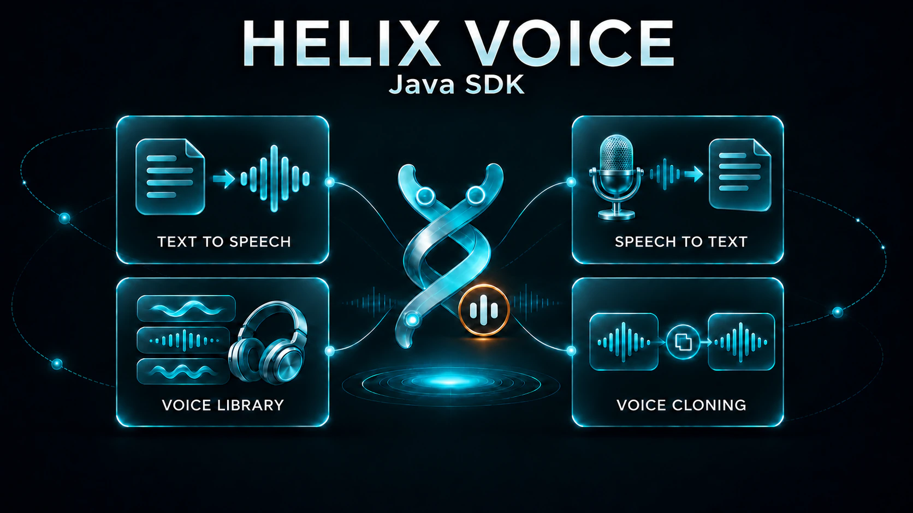

<p align="center">
  
</p>

<h1 align="center">Helix Voice SDK for Java</h1>

<p align="center">
  Generate speech, transcribe audio, and manage voices from your Java application.
</p>

<p align="center">
  <a href="https://central.sonatype.com/artifact/net.helixvoice/helix-voice-sdk-java"></a>
</p>

<p align="center">
  <a href="https://docs.helixvoice.net/en/api/sdks/">Developer Docs</a> ·
  <a href="examples/">Examples</a> ·
  <a href="https://github.com/Advai-X/helix-voice-java/releases/latest">Release Notes</a>
</p>

## Install

Requires JDK 11 or later and Maven 3.

### Maven Central

Add this dependency to your project's `pom.xml`. Maven resolves it from Central. [Maven Central artifacts](https://repo.maven.apache.org/maven2/net/helixvoice/helix-voice-sdk-java/0.2.0/)

```xml
<dependency>
    <groupId>net.helixvoice</groupId>
    <artifactId>helix-voice-sdk-java</artifactId>
    <version>0.2.0</version>
</dependency>
```

See [alternative installation](#alternative-install-from-the-github-release) for the GitHub release ZIP.

## Quickstart

Set `HELIXVOICE_API_KEY` to a server-side API key with `voices:read`, `speech:write`, and `generations:read` scopes.

```sh
export HELIXVOICE_API_KEY='YOUR_API_KEY'
```

Save this as `src/main/java/example/Speech.java` in your Maven project. For a new project, use the [example POM](examples/pom.xml) as a starting point.

```java
package example;

import java.net.URI;
import java.nio.file.Path;
import java.time.Duration;
import net.helixvoice.sdk.HelixVoiceClient;

public final class Speech {
    public static void main(String[] args) throws Exception {
        var apiKey = System.getenv("HELIXVOICE_API_KEY");
        var baseUrl = URI.create(System.getenv().getOrDefault(
                "HELIXVOICE_BASE_URL", "https://api.helixvoice.net"));
        var client = new HelixVoiceClient(apiKey, baseUrl, Duration.ofSeconds(180));
        var voices = client.listVoices();
        if (voices.isEmpty()) {
            throw new IllegalStateException("No voices are available to this account.");
        }

        var generation = client.saveSpeech("Hello from Helix Voice.", voices.get(0).getId(), Path.of("speech.wav"));
        System.out.printf("Saved speech.wav (generation %s)%n", generation.getId());
    }
}
```

From the directory containing your `pom.xml`, run:

```sh
mvn compile org.codehaus.mojo:exec-maven-plugin:3.5.0:java -Dexec.mainClass=example.Speech
```

On success, `speech.wav` is saved in your current directory and the generation ID is printed. See also the [repository example](examples/src/main/java/example/Speech.java).

## Usage examples

- [Transcribe a local audio file](examples/src/main/java/example/Transcribe.java) and print its Mandarin transcript. [Transcription guide](https://docs.helixvoice.net/en/api/sdks/#transcribe-audio)
- [Clone a private voice](examples/src/main/java/example/CloneVoice.java) with reference audio, its transcript, and the speaker's explicit consent. [Voice cloning guide](https://docs.helixvoice.net/en/api/sdks/#clone-a-voice)
- [List retained generations or download a WAV](examples/src/main/java/example/DownloadHistory.java) by generation ID. Running the example without an ID lists the records. [Download guide](https://docs.helixvoice.net/en/api/sdks/#download-generation-history)

## SDK methods

| Task | SDK methods | Required scopes |
| --- | --- | --- |
| Read service capabilities and limits | `getCapabilities` | `capabilities:read` |
| List public and account-owned voices | `listVoices` | `voices:read` |
| [Generate metadata or save speech as WAV](examples/src/main/java/example/Speech.java) | `generateSpeech`, `saveSpeech` | `speech:write`, plus `generations:read` when saving |
| Transcribe a Mandarin audio file | `createTranscription` | `transcriptions:write` |
| Clone or delete a private voice | `cloneVoice`, `deleteVoice` | `voices:write` |
| List generations or download WAV audio | `listGenerations`, `downloadGeneration` | `generations:read` |
| Delete a generation | `deleteGeneration` | `generations:write` |

## API keys and account access

For production use, ask your account administrator for a scoped API key and set `HELIXVOICE_API_KEY` in your server environment. The speech example needs `voices:read` to look up a voice, `speech:write` to generate speech, and `generations:read` to download the WAV. Keep the key in server-side secret storage. [API keys and scopes](https://docs.helixvoice.net/en/api/authentication/)

The examples default to `https://api.helixvoice.net`. Set `HELIXVOICE_BASE_URL` when running them against a trusted staging or test API.

## Capabilities and scopes

See [SDK methods](#sdk-methods) for the scope of each operation. Voice cloning requires the speaker's explicit consent. Consult the capabilities response for the limits of your environment. [Developer API reference](https://docs.helixvoice.net/en/api/speech/)

## Troubleshooting

- **401 Unauthorized** means the key is missing, invalid, expired, or revoked. Check the key used by the running process.
- **403 Forbidden** with `insufficient_scope` means the key lacks a required permission. Check the scopes for each request.
- **429 Too Many Requests** means a quota or rate limit was reached. Honor `Retry-After` when available.
- **Speech generated but WAV saving failed** means you can recover the generation ID from the save error and retry the download while that record is retained. Retrying generation can consume quota again.

Keep the request ID when investigating an API error. [Errors and rate limits](https://docs.helixvoice.net/en/api/errors/) · [Generation downloads](https://docs.helixvoice.net/en/api/speech/#history-and-audio)

## License

Licensed under the [Apache License, Version 2.0](LICENSE).

## Alternative install from the GitHub release

Download and extract the [v0.2.0 ZIP from GitHub](https://github.com/advai-x/helix-voice-java/releases/tag/v0.2.0). From the extracted directory, install the SDK and its POM into your local Maven repository.

```sh
mvn org.apache.maven.plugins:maven-install-plugin:3.1.4:install-file \
  -Dfile=helix-voice-sdk-java-0.2.0.jar \
  -DpomFile=helix-voice-sdk-java-0.2.0.pom \
  -Dsources=helix-voice-sdk-java-0.2.0-sources.jar \
  -Djavadoc=helix-voice-sdk-java-0.2.0-javadoc.jar
```

Then add the [dependency above](#maven-central) to your project.
